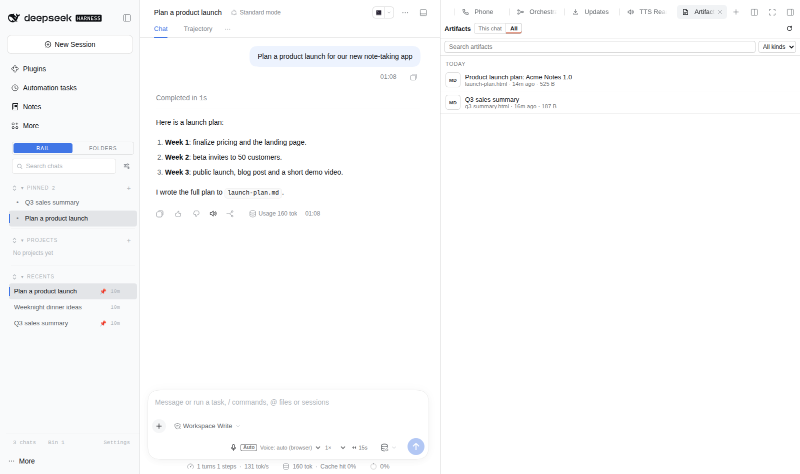

# dsh-workspace-rail

[](https://www.npmjs.com/package/@lucagiftzek/dsh-workspace-rail)

A workspace-first sidebar for DSH: pinned chats, projects as folders, live Recents and unread markers.

```bash
dsh plugin --profile web add @lucagiftzek/dsh-workspace-rail
# or from GitHub: dsh plugin --profile web add github:lucagiftzek/dsh-workspace-rail
# then restart dsh web
```



<sub>Screenshot from a demo DSH instance with sample data.</sub>

A workspace-first sidebar rail for the DeepSeek Harness (DSH) web GUI: Pinned
chats (folders included), Projects (isolated workspace folders with their own
instructions and files), a virtualized Recents list ordered by the last
finished turn, graded transcript search, unread markers and a live browser tab
title.

Runs on DSH 0.2.x (tested on 0.2.1) and on DSH 0.1.5 with the same build.

## Install

Install from npm: `dsh plugin --profile web add @lucagiftzek/dsh-workspace-rail`, or from GitHub: `dsh plugin --profile web add github:lucagiftzek/dsh-workspace-rail`.

```sh
dsh plugin --profile web add @lucagiftzek/dsh-workspace-rail
# or from GitHub: dsh plugin --profile web add github:lucagiftzek/dsh-workspace-rail
```

The package declares `dsh.bundle`, so `dsh plugin add` lists it in the
profile bundles; restart `dsh web` to load the host half. To work on a
checkout instead:

```sh
git clone https://github.com/lucagiftzek/dsh-workspace-rail
cd dsh-workspace-rail && npm install && npm run build
dsh plugin --profile web add link:$PWD
```

`lib/` is committed, so a plain install needs no build step.

### Options

Row options go in the `- id: workspace-rail` row of your profile
`cordis.patch.yml`, under `config:`.

| Option | Default | Meaning |
|---|---|---|
| `enableRail` | `true` | Mount the rail in the web GUI. |
| `stripeEdge` | `right` | Edge of the colour stripe on chat, folder and project rows. |
| `recentsMaxRows` | `5000` | Cap on rows kept in Recents. |
| `projectsRoot` | `~/dsh-projects` | Where per-project folders are created. |
| `trustedHosts` | `[]` | Host names (besides loopback) the rail API accepts. Empty means the authorities DSH itself trusts: every `--trusted-host` value of the `dsh web` command line, plus the comma-separated `DSH_WORKSPACE_RAIL_TRUSTED_HOSTS` environment variable. |
| `enablePointerHealth` | `true` | Check that linked project files still exist. |
| `enableWindowsIndex` | `false` | DSH 0.1.5 only: transcript-window bridge for search. |

If you serve DSH under a public host name behind a reverse proxy, you already
start it with `dsh web --trusted-host app.example.com` (the core's own API
fence needs it), and the rail picks that up with no extra setting.

## How it is built

Dual-face plugin (host and browser), the same harness contract as
`dsh-session-pin`:

- `src/index.ts`: host face. Serves the rail's own API and file store; on
  DSH 0.1.5 it also registers the `workspace-rail` settings namespace (see
  "DSH versions").
- `src/client.ts`: browser face. Catalog sync (sessions and workspaces
  snapshots), the rail panel (vanilla DOM, outside React's tree), virtualized
  Recents.
- `src/scoring.ts`: pure 4-tier graded search scoring (title x40, doc
  names and tags x15, first 3 messages x8, last 3 messages x4, 14-day recency
  decay, pinned x1.2 boost).

## Placement

The rail **is** the sidebar list: the browser face registers the
`sidebar.workspaces` seat at priority -2, one below dsh-metafolder-plugin
(-1), which is one below the shipped browser (0). The header's
**Rail | Folders** switch unregisters the seat to reveal the folder view
underneath (nothing is hidden with CSS); a **Rail** button in
`sidebar.footer.action` brings it back. The choice is per browser
(`localStorage['dsh.workspace-rail.view']`). Hosts without a slot registry
fall back to a floating panel.

The rail hides the "Pinned sessions" footer button of dsh-session-pin, since
the rail's PINNED section lists the same pins; pinning itself is untouched.
One CSS rule in `src/rail-style.ts` (`PIN_FOOTER`); delete it to bring the
button back.

Colours come from the host's `--dsw-alias-*` tokens, so the rail follows
light and dark mode and any theme on top; a theme plugin can also set
`--tz-*` variables (accents, display font, radius, shadows). Subagent
transcripts are excluded from Recents; rows show a compact age and open the
chat on click.

**Rename:** triple-click a chat title, or the row menu, Rename. Enter saves,
Esc cancels, clicking away saves. It goes through the host
(`ctx.sessions.binding(id).session.rename`), which also pins the title
against automatic regeneration.

## Projects

Clicking a project opens its view inside the rail: **Chats** first (same rows
as Recents: open, rename, age; row menu, Remove from project), with
**+ New chat** (created and filed in the project, then opened) and
**Add chats...** (a searchable picker). **Files** below: paste a path or URL
and press Enter, or drop text paths; name and kind are inferred
(`src/files.ts`). Clicking a file opens it in dsh-better-sidebar's editor when
that plugin is installed (optional `ctx.inject(['betterSidebar'])`); links
open in a new tab. Files the server cannot find are marked and can be removed
in one click. Files are links only: nothing is copied.

Moves, removals and deletes apply immediately with an **Undo** toast.

### Projects are folders

Each project gets `~/dsh-projects/<name>-<id>/` (option `projectsRoot`).
**+ New chat** registers that folder as a DSH workspace (titled like the
project) and opens its chat, the same path as DSH's New Session. DSH's own
instructions loader then applies the folder's `AGENTS.md`, which the rail
writes from the project's **Instructions**, **Project memory** (the assistant
keeps `PROJECT-MEMORY.md`) and **Answer from project files only** settings.
Uploads land in the folder, so the assistant can read them. Chats started in
the folder belong to the project automatically.

## Search, models, archive

- **project_search** (agent tool, `src/host/search.ts`): BM25 over ~30-line
  passages of the project folder and linked files (text and code, PDF via
  `pdftotext`, .docx via `unzip`); hits carry `file:line`. Scoped to the
  calling chat's project.
- **Default model** per project: picked from DSH's model catalog and applied
  to **+ New chat** before the first message.
- **Archive** hides a project behind "Archived (n)" with everything kept.
  **Delete** asks first and keeps the folder unless ticked; the host only
  removes the folder the saved state records, and only inside `projectsRoot`.

## Layout

Pinned and Projects have a fixed header and their own scrolling list, N rows
tall (drag the line under a section, or use the steppers in settings);
clicking a header folds the section; Recents fills the rest. The small button
before each header label expands that section to the full sidebar height;
pressing it again restores the previous layout.

Recents is ordered by the last COMPLETED turn, newest first, and updates live:
the rail stamps the running to idle edge the host pushes for every chat (no
polling) and keeps the stamps per browser in localStorage
(`dsh.workspace-rail.completedAt`).

## Browser tab (icon and title)

- **Icon**: a small pixel rail icon (`assets/`). The build inlines it into
  `lib/client.js` as data: URLs, so the browser makes no request for it.
  Replace the four files in `assets/` and rebuild to show your own logo. The
  shell's own icon links come back when the feature is off.
- **Title**, first rule that applies (`src/tab-title.ts`):
  1. unread replies: `(N) <first words of the newest unread reply>`, or
     `(N) <kitty frame>` while the open chat is working;
  2. no chat on screen: `DeepSeek Harness`;
  3. the open chat is working: a one-line kitty animation;
  4. the open chat is idle: the first words of its last message.
- **Unread**: a chat is unread when this browser saw it finish a turn after
  it was last on screen. Subagents, binned and archived chats do not count.
  Tabs share the stamps through localStorage.
- **Row markers**: a small blue dot on every unread chat in Pinned, Recents
  and project lists, on a project row or folded folder holding one, and on the
  Rail icon of the collapsed sidebar.
- **Off switch**: rail Settings, "Browser tab" Live or Off.

## Persistence and security

State lives in `~/.dsh/workspace-rail/state.json`, served by the rail's own
API (`/workspace-rail/api`, `src/host/api.ts`), not by DSH settings: DSH gives
every non-loopback browser a memory-mode settings scope, so writes there would
never reach the host. The browser loads the host copy first, merges in
anything only it holds, then saves debounced with a revision check (409 means
another tab won; it adopts that state).

DSH does not authenticate plugin routes, so the API checks every request:
loopback peer (DSH behind a reverse proxy on the same machine) and a trusted
Host; writes also need a matching Origin, the
`X-Requested-With: dsh-workspace-rail` marker and the harness session cookie.

## DSH versions

The same build runs on DSH 0.1.5 and on DSH 0.2.x (peers `>=0.1.2-rc.1 <0.3.0`).
The host picks its path by capability, not by version string:

- **0.1.5** (`ctx.settings.register` exists): the `workspace-rail` namespace
  is registered, seeds `state.json` on a first boot, and carries the
  transcript-window bridge (off by default).
- **0.2.x** (`ctx.settings` is the forms service): `state.json` is the only
  store and the window bridge is not available.

## Development

```sh
npm install
npm run typecheck && npm test && npm run build
```

The tests use vitest and jsdom and need no running DSH.

## License

Apache-2.0, see [LICENSE](LICENSE).

---

## More plugins by the same author

All of them are open source and run on DeepSeek Harness 0.2.x (several on 0.1.5 too).

| Plugin | What it does |
|:---|:---|
| [dsh-artifacts](https://github.com/lucagiftzek/dsh-artifacts) | An Artifacts tab that lists the files an agent produced and previews them in place, plus a template library agents can use and extend |
| [dsh-mail](https://github.com/lucagiftzek/dsh-mail) | Mail client and agent mail tools: IMAP, POP3, SMTP and OAuth2 accounts, scheduled and bulk sends with unsubscribe handling |
| [dsh-note-keeper](https://github.com/lucagiftzek/dsh-note-keeper) | Obsidian-compatible Markdown notes in the sidebar with search, graph, audio notes and transcription, OCR and client-side encryption |
| [dsh-phone](https://github.com/lucagiftzek/dsh-phone) | SMS and calls (Twilio, SIP via Asterisk) with call audio through your own server, live voicemail and Telegram |
| [dsh-voice](https://github.com/lucagiftzek/dsh-voice) | Read-aloud, dictation and language-aware speech with 23 TTS and STT providers, per-language routing and word highlighting |
| [dsh-orchestrator](https://github.com/lucagiftzek/dsh-orchestrator) | Agent swarm and task orchestration: an Orchestrate tab, `orch_*` tools, runners, provider cards and a machine API |
| [dsh-workspace-rail](https://github.com/lucagiftzek/dsh-workspace-rail) (this one) | A workspace-first sidebar rail: pinned chats, projects as folders, live Recents, search and unread markers |
| [DSH-Idle-Watchdog](https://github.com/lucagiftzek/DSH-Idle-Watchdog) | Idle-chat nudges and an authenticated HTTP API that posts a prompt into any chat |
| [dsh-plugin-updates](https://github.com/lucagiftzek/dsh-plugin-updates) | Update checker that only offers releases your running DSH core can load |
| [dsh-subagent-tiering](https://github.com/lucagiftzek/dsh-subagent-tiering) | Subagents default to a cheaper sibling of the parent model unless the agent names a route |
| [dsh-fs-reobserve](https://github.com/lucagiftzek/dsh-fs-reobserve) | Ends self-inflicted stale-file errors after an agent's own shell commands |
| [dsh-request-image-cap](https://github.com/lucagiftzek/dsh-request-image-cap) | Clamps every image sent to the model to a pixel cap, fixing many-image request errors |
| [dsh-seal](https://github.com/lucagiftzek/dsh-seal) | An encrypted channel in front of DSH: a Go reverse proxy plus a service worker that seal all DSH browser traffic |

Built by Luca Tzekos, who also makes [**Job Opportunities API**](https://jobopportunitiesapi.org): employer-direct job data with per-field provenance you can verify yourself, free to read and available as an API. If this plugin is useful to you, a star on this repo or a look at [jobopportunitiesapi.org](https://jobopportunitiesapi.org) is the best thanks.
